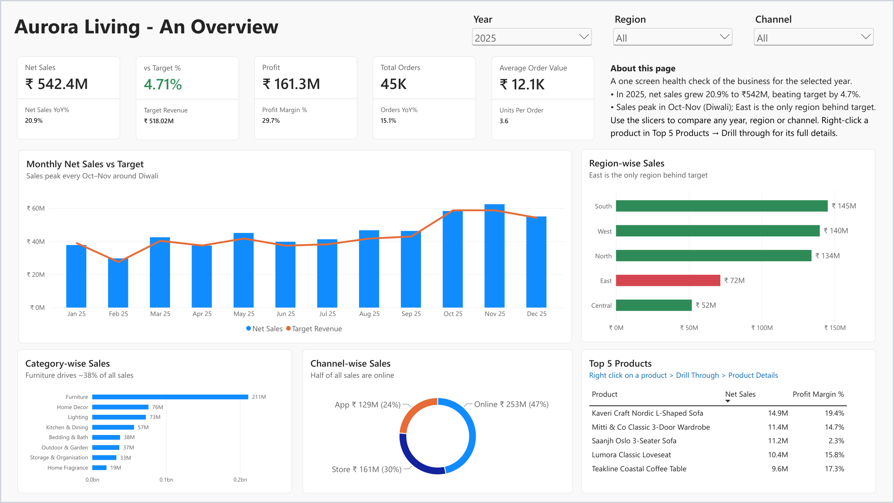

<h2 align="center">Hi, I'm Sushmita</h2>

  <b>Business Analyst</b> · SQL · Advanced Excel · Power BI 
  Problem solver first, data person second. I dig into what's really holding a business back and then make the data tell the story. Startup-trained at Groww and Noon, so I move fast, own the problem and keep levelling up.

  
  

---

### 💫 About me

- 📊 Business Analyst with experience at **Groww** (fintech) and **Noon** (e-commerce), across marketing, acquisition, engagement and retention
- 🔎 I turn business questions into SQL, dashboards and experiments, and the results into decisions
- 🛠️ I work end to end: requirements, data cleaning, modelling, reporting and the final recommendation
- 🌱 Currently learning **Python** and **agentic AI** to automate everyday analysis

### 🧰 Tools and skills

  
  
  
  
  
  
  

### 📊 Featured projects

#### [Retail Performance & Customer Analytics Dashboard](https://github.com/sushmita26de-debug/Retail-Sales-Dashboard-Aurora-Living) · Power BI

A 6-page interactive Power BI report for a simulated omnichannel retailer, covering sales vs target, profitability, customers, operations and marketing ROI.

📄 [Read the case study](https://github.com/sushmita26de-debug/Retail-Sales-Dashboard-Aurora-Living/blob/main/README.pdf) · 🖼️ [See all six pages](https://github.com/sushmita26de-debug/Retail-Sales-Dashboard-Aurora-Living/blob/main/Dashboard_Snapshots.pdf) · ⬇️ [Download the Power BI template](https://github.com/sushmita26de-debug/Retail-Sales-Dashboard-Aurora-Living/raw/main/Retail_Sales_Dashboard_Aurora_Living.pbit)
